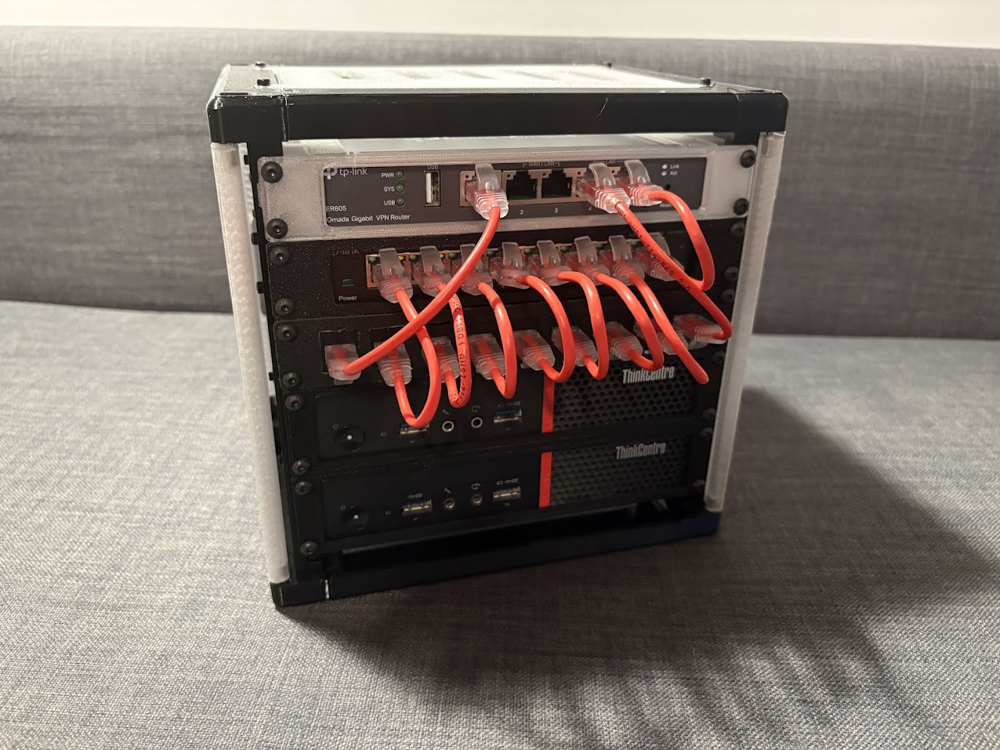

# Completed Builds

A gallery of completed rackstack builds. Feel free to add your own by submitting a PR with an image in the `images/` folder and a section below!

---

<!--
To add your build:
1. Place your image(s) in the completed-builds/images/ directory.
2. Add a new section below using the following template:

### Build Title

- **Builder:** Your name or handle
- **Profile:** mini / micro / nano / custom
- **Notes:** Any notes about the build (parts used, modifications, etc.)

---
-->

### Self Contained Home Proxmox Lab

- **Builder:** jtgis
- **Profile:** micro
- **Notes:** A modem, a switch, two sff pcs, some keystones, and a bunch of patch cables created this self contained home lab that runs proxmox.
